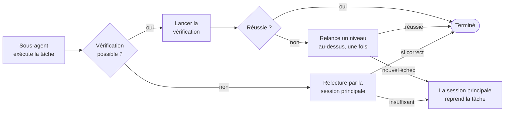
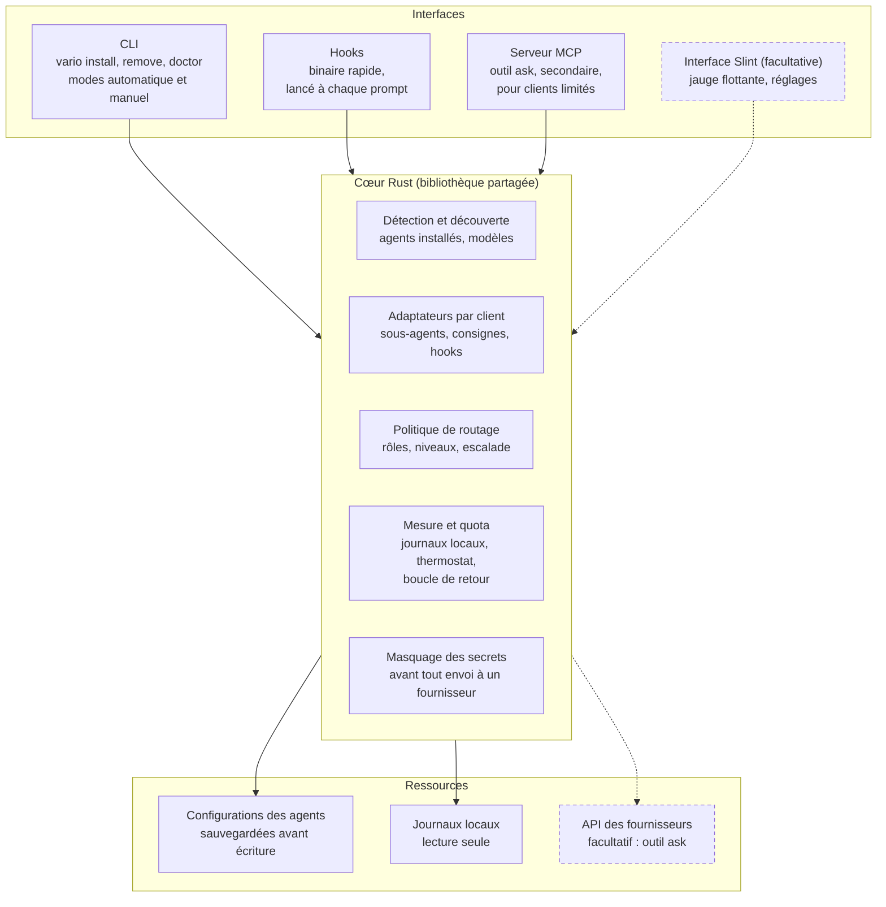

# Vario — document de conception du routeur de modèles multi-agents

16 octobre 2026 · Kaabaoui Othman

## Contexte et problème

Vario confie chaque tâche d'un agent d'IA au modèle le moins coûteux capable de la réussir, sur tous les agents installés localement, pour préserver les quotas sans sacrifier la qualité.

Le constat de départ tient en trois points :

- **Modèle surdimensionné.** On choisit le modèle le plus puissant pour coder correctement, puis on pose dans la même session des questions simples qu'un petit modèle traiterait aussi bien, au prix fort.
- **Oubli de changer.** Absorbé par le développement et le suivi de l'agent, l'utilisateur ne pense pas à descendre vers un modèle économique, ni à remonter quand une tâche l'exige.
- **L'inverse coûte aussi.** Un modèle trop faible échoue, et les nouvelles tentatives consomment plus qu'un bon choix initial.

Le problème dépasse désormais le code. Le vibe coding amène des non-développeurs, et les mêmes agents pilotent de plus en plus des tâches non-code (montage et génération de vidéos, images, documents) via des connecteurs et des serveurs MCP, avec les modèles d'Anthropic, d'OpenAI et d'autres.

**Public de la première version** : les utilisateurs d'agents installés localement (CLI, IDE, applications de bureau), pour le code comme pour les tâches pilotées par MCP. La première version désigne ici le périmètre couvert par ce document, atteint au fil des phases de la feuille de route ; elle ne se confond pas avec la phase 1. La phase 1 n'en sert qu'une partie : les développeurs qui utilisent Claude Code, Cursor ou OpenCode, pour le code comme pour les tâches MCP pilotées depuis ces agents, sans interface graphique. Les non-développeurs sont visés à partir de la phase 3, qui apporte l'interface, et les applications de bureau comme Claude Desktop à partir de la phase 4. La phase qui donne lieu à la première publication reste à trancher (voir Questions ouvertes).

**Hors périmètre en v1** : les plateformes web à crédits (Lovable, Bolt, Replit…), qui n'exposent aucun levier local, et les applications métier qui choisissent leur modèle en interne.

## Positionnement

Le vide à combler : la délégation aux modèles économiques et la mesure de la consommation, pour tous les agents locaux, installées en une commande comme le fait Handoff pour la mémoire.

| Outil | Rôle | Agents couverts | Ce qu'on en reprend |
|---|---|---|---|
| [Handoff](https://github.com/kdev1966/Handoff-CLI) (même auteur) | continuité du contexte entre agents | 14 clients | modèle d'installation (auto/manuel, aperçu, sauvegardes, doctor, remove), formats de hooks par client, masquage des secrets |
| [Frugal](https://github.com/ThomasLangbroek/frugal) | délégation aux sous-agents économiques, escalade sur échec vérifié | Claude Code | table de décision, escalade vérifiée, compte rendu imposé aux sous-agents, garde-fous par hooks |
| [Paceline](https://github.com/mn-youssef/paceline) | mesure : quota, coûts, conseils par session | Claude Code | quota réel via la ligne de statut, lecture des journaux locaux, détection a posteriori des erreurs de routage, coûts cachés |
| [AgentKit](https://github.com/Ajaysable123/AgentKit) | orchestration et routage par rôle | Claude Code complet, autres via règles textuelles | confirmation qu'une config unique peut viser plusieurs clients |
| [Harness CLI](https://github.com/rexleimo/harness-cli) | couche de travail large : mémoire, équipes d'agents, routage | Codex, Claude, Gemini, OpenCode | rien directement : périmètre beaucoup plus large que le nôtre |
| [claude-model-router](https://pypi.org/project/claude-model-router/) | routage pour l'API Claude + hook contre l'héritage du modèle coûteux | Claude Code | constat sur la perte du cache à chaque changement de modèle |

Vario ne remplace aucun de ces projets. Il s'en distingue par trois choix : couvrir plusieurs agents avec leurs mécanismes natifs, traiter les tâches non-code pilotées par MCP, et piloter la politique par le quota réel plutôt que par un budget en dollars.

Frugal sera cité honnêtement dans le README, et une collaboration avec son auteur est envisageable (les deux projets sont sous licence MIT).

## Principes directeurs

Sept principes guident toutes les décisions ; en cas de conflit, ils s'appliquent dans cet ordre.

1. **Correction avant économie.** Une tâche ratée par un modèle trop faible coûte plus qu'un bon choix initial : on ne descend que là où la réussite est vérifiable ou très probable.
2. **Déléguer plutôt que changer de modèle.** Le cache du prompt est propre à chaque modèle : changer de modèle en cours de session le perd. La session principale garde son modèle ; seul le travail délégué part sur un modèle économique.
3. **Utiliser les mécanismes natifs de chaque agent.** Sous-agents, consignes et hooks fournis par l'agent lui-même : pas de proxy, pas de clé API obligatoire, compatible avec les abonnements.
4. **Conseiller par défaut, contraindre sur demande.** L'installation automatique ne pose que des conseils ; les garde-fous bloquants exigent un choix explicite.
5. **Sobriété.** Vario économise des tokens et ne doit pas en gaspiller : texte injecté minimal, rien sur la ligne de statut, et aucun processus permanent pour le cœur et les hooks, qui ne s'exécutent qu'à l'appel. L'interface Slint est facultative : l'utilisateur la lance s'il le souhaite, et rien dans le fonctionnement de Vario ne dépend d'elle.
6. **Local et respectueux.** Aucune donnée envoyée à un tiers par Vario lui-même, aucune valeur secrète lue, chaque fichier modifié sauvegardé, désinstallation complète. L'outil `ask`, qui envoie des sous-tâches à l'API d'un fournisseur, contredit ce principe tel qu'il est écrit ; la manière de résoudre cette contradiction reste à trancher (voir Questions ouvertes).
7. **Honnêteté sur les limites.** Ce qui n'est pas mesurable ou pas faisable sur un client est dit clairement, dans Vario comme dans le README.

## Politique de routage

La politique repose sur trois rôles valables dans tous les métiers, plus une règle préalable : si une commande déterministe suffit, aucun modèle n'est appelé.

| Rôle | Exemples en code | Exemples hors code (via MCP) | Niveau |
|---|---|---|---|
| **Décider et juger** | concevoir, déboguer, arbitrer, relire | comprendre la demande créative, choisir le montage, valider le rendu | session principale (modèle puissant) |
| **Exécuter une action définie** | renommer, appliquer un motif connu, implémenter une tâche cadrée | appeler un outil MCP avec des paramètres clairs, traiter un lot d'images, enchaîner des opérations connues | sous-agent économique ou intermédiaire |
| **Lire et résumer** | localiser du code, extraire des champs, résumer un fichier | résumer la sortie d'un outil, lister les métadonnées de clips, extraire d'un document | sous-agent économique |

Les niveaux sont exprimés en capacités (économique, intermédiaire, puissant), jamais en noms de modèles : la découverte associe chaque niveau aux modèles réellement disponibles dans chaque client. Le critère qui fait choisir entre économique et intermédiaire pour le rôle « exécuter », et le mécanisme d'association entre niveaux et modèles, restent à trancher (voir Questions ouvertes).

Restent toujours dans la session principale : les changements sensibles pour la sécurité, les opérations destructrices, les demandes ambiguës et tout ce qui demande le jugement de l'utilisateur.

### Escalade sur échec vérifié



On ne monte d'un niveau qu'après un échec observé, et une seule fois. Le sous-agent exécute la tâche ; si une vérification est possible (tests, commande, critère explicite), elle est lancée. Si elle réussit, la tâche est terminée. Si elle échoue, la tâche est relancée une seule fois au niveau au-dessus ; un nouvel échec renvoie la tâche à la session principale. Quand aucune vérification n'est possible, la session principale relit le résultat : s'il est correct, la tâche est terminée ; s'il est insuffisant, elle reprend la tâche elle-même. Le schéma comporte donc deux décisions (vérification possible, vérification réussie) et au plus une remontée.

Le signal « ESCALADER : oui » d'un sous-agent n'est qu'un indice : seule une vérification qui échoue déclenche la remontée d'un niveau, et seule une relecture jugée insuffisante renvoie la tâche à la session principale. On ne commence jamais par un niveau coûteux si la politique ne l'exige pas.

### Format de consigne de délégation

Un modèle économique qui reçoit une consigne floue échoue, et l'escalade annule l'économie. Toute délégation suit donc une structure fixe, inspirée des passations de Handoff :

```
OBJECTIF : <le résultat attendu, en une phrase>
ENTRÉES : <pointeurs précis : fichiers et lignes, identifiants, paramètres d'outil>
CONTRAINTES : <ce qu'il ne faut pas faire, formats attendus>
VÉRIFICATION : <la commande ou le critère qui prouvera la réussite>
```

On transmet des pointeurs, jamais du contenu recopié : le sous-agent relit lui-même au tarif économique.

### Format de compte rendu

Chaque sous-agent termine par le pied de page de Frugal, qui rend l'escalade décidable :

```
RÉSULTAT : <une ligne>
VÉRIFICATIONS : <commandes lancées et résultats, ou « aucune »>
INCERTITUDES : <ou « aucune »>
ESCALADER : oui|non - <raison>
```

## Hygiène MCP

Les serveurs MCP sont une source de consommation à part entière, indépendante du choix du modèle, et Vario les traite comme un second levier.

| Coût | Origine | Parade |
|---|---|---|
| **Fixe** | la description de chaque outil connecté est envoyée à chaque tour, utilisée ou non | n'activer un connecteur que dans les projets ou les sous-agents qui en ont besoin ; signaler les connecteurs jamais utilisés |
| **Variable** | la sortie d'un outil entre dans le contexte au tarif du modèle principal, puis est renvoyée à chaque tour | confier les appels à grosse sortie à un sous-agent économique, qui ne renvoie qu'un résumé |
| **Externe** | images et vidéos facturées à l'unité ou à la seconde par le service appelé | produire des brouillons en basse qualité, lancer le rendu final seulement après validation |

L'isolement dans un sous-agent est la parade la plus forte : les sorties volumineuses n'entrent jamais dans le contexte coûteux de la session principale.

Trois limites sont assumées. Les coûts externes ne sont mesurables que si le serveur MCP les rapporte, ce qui est rare. Certains clients chargent désormais les outils MCP à la demande, ce qui réduit le coût fixe : à vérifier client par client. Enfin, Vario ne modifie jamais la liste des connecteurs sans accord : il signale et propose.

## Mesure et pilotage par le quota

Vario mesure la consommation à partir des journaux locaux des agents et ajuste la politique selon le pourcentage réel du quota d'abonnement, pas selon un budget en dollars.

### Sources de mesure

- **Journaux de session locaux** : toute l'activité, y compris l'historique antérieur à l'installation, ce qui permet une comparaison avant et après. Paceline le fait pour Claude Code ; l'emplacement et le format pour chaque autre client sont à vérifier.
- **Quota réel** : Claude Code transmet les limites de 5 heures et hebdomadaire à sa ligne de statut. Vario lit cette donnée sans occuper la ligne de statut (lecture de ce que capture déjà un outil comme Paceline, ou autre mécanisme à définir, voir Questions ouvertes). Pour les autres clients, disponibilité à vérifier.
- **Comptes rendus des sous-agents** : nombre d'escalades et taux de réussite par niveau.

### Thermostat de quota (seuils réglables)

Claude Code expose deux limites, celle de 5 heures et la limite hebdomadaire. La limite suivie par le thermostat (l'une, l'autre ou la plus haute des deux) reste à trancher (voir Questions ouvertes).

| Quota consommé | Comportement |
|---|---|
| moins de 50 % | politique normale |
| 50 à 80 % | délégation renforcée : tout ce qui peut partir sur un modèle économique y part |
| 80 à 100 % | avertissement à chaque prompt, sous-agents coûteux déconseillés |
| limite atteinte | proposition de changer d'agent, avec rappel d'enregistrer une passation Handoff |

Les sous-agents économiques restent toujours autorisés : les bloquer renverrait le travail vers la session principale, qui est justement ce qui vide le quota.

### Boucle de retour

Des règles détectent a posteriori les erreurs de routage, par exemple un modèle puissant qui a passé la majorité de ses tours sur de petites modifications, ou un niveau dont le taux d'escalade est élevé. Le rapport propose alors d'ajuster la politique ; il ne la modifie jamais seul.

**Limites** : les coûts affichés pour un abonné sont une valeur équivalente au tarif API, pas ce qu'il paie ; les coûts externes des serveurs MCP restent souvent invisibles.

## Leviers par client

Le tableau compte sept clients : six agents CLI et IDE, plus Claude Desktop. Le mécanisme central, des sous-agents avec leur propre modèle, existe dans cinq des six agents CLI et IDE (Claude Code, Cursor, OpenCode, Codex, Gemini CLI) ; pour VS Code, un comparatif l'indique mais ce n'est pas vérifié, et Claude Desktop reste entièrement à vérifier. Les différences portent sur la délégation automatique, les hooks et l'accès au quota.

| Client | Sous-agents avec modèle | Délégation automatique | Hooks utiles | Quota exposé | Mesure |
|---|---|---|---|---|---|
| **Claude Code** (phase 1, vérifié) | `.claude/agents/*.md`, champ `model` : alias, identifiant complet ou `inherit` ; défaut global via `CLAUDE_CODE_SUBAGENT_MODEL` | oui, selon la description de l'agent | début de session, chaque prompt, avant outil, fin de sous-agent ([Frugal](https://github.com/ThomasLangbroek/frugal)) | oui, via la ligne de statut | journaux locaux ([Paceline](https://github.com/mn-youssef/paceline)) |
| **[Cursor](https://cursor.com/docs/subagents)** (phase 1, vérifié) | `.cursor/agents/*.md`, champ `model` : identifiant Cursor (`composer-2`, `claude-opus-5[effort=high]`…) ou `inherit` ; un homonyme dans `.cursor/` masque celui de `.claude/` | oui, encouragée par la description ; le parent peut aussi nommer un modèle | début de session (ajout de contexte), avant envoi du prompt (blocage seulement), début de sous-agent (voit le modèle, peut refuser), fin de sous-agent ([hooks](https://cursor.com/docs/hooks)) | non en local ; tableau de bord web | hooks et transcriptions, sans tokens |
| **[OpenCode](https://opencode.ai/docs/agents.md)** (phase 1, vérifié) | `.opencode/agents/*.md`, `mode: subagent`, `model: fournisseur/modèle#variante` | selon la description de l'agent | extensions JS/TS : `chat.message` (peut changer le modèle du tour, non utilisé par Vario : voir les constats), événements de session et de message | non (surtout des clés API) | coût et tokens par message, calculés par OpenCode |
| [Codex](https://developers.openai.com/codex/subagents) (phase 2) | `.codex/agents/*.toml`, `model` et `model_reasoning_effort` | **non** : uniquement sur demande explicite | début de session et fin de tour, approbation unique | à vérifier | à vérifier |
| [Gemini CLI](https://geminicli.com/docs/hooks/reference/) (phase 2) | `.gemini/agents/*.md`, `model` facultatif | à vérifier | début de session, `BeforeAgent`, `BeforeModel` | à vérifier | à vérifier |
| VS Code (phase 2) | oui selon un comparatif, non vérifié ; plafonné au niveau du modèle principal | à vérifier | début de session et arrêt (Handoff) | à vérifier | à vérifier |
| Claude Desktop | à vérifier | à vérifier | aucun connu | à vérifier | à vérifier |

Les vérifications de la phase 0 donnent sept constats qui orientent la conception.

- **Le partage de dossier avec Cursor se règle par homonymie.** Cursor lit `.claude/agents/`, mais un sous-agent de même nom dans `.cursor/agents/` prend le dessus. Pour chaque sous-agent Claude Code, Vario écrit un homonyme Cursor avec un identifiant de modèle Cursor. Cursor lit aussi `.codex/agents/` ; la priorité de `.cursor/agents/` sur ce dossier reste à vérifier. Le cas ne se pose pas en phase 1, où Vario n'écrit aucun fichier Codex. En phase 2, chaque sous-agent Codex écrit dans `.codex/agents/` devra recevoir lui aussi un homonyme Cursor, ou Vario devra vérifier que Cursor l'ignore ou l'interprète correctement.
- **Cursor exécute aussi les hooks de Claude Code**, réglage actif par défaut. Si Vario installe en plus des hooks Cursor natifs, ils tourneraient deux fois. Le champ `cursor_version` et la variable `CURSOR_VERSION` indiquent seulement que le hook tourne dans Cursor, pas de quelle configuration il vient. Proposition : chaque configuration appelle le binaire avec un argument qui indique sa provenance, `vario hook --via claude` dans la configuration de Claude Code et `vario hook --via cursor` dans celle de Cursor. Quand le binaire détecte Cursor, reçoit `--via claude` et constate qu'un hook Cursor natif de Vario est installé, il se termine sans rien faire, et le hook Cursor natif fait le travail. Dans tous les autres cas, `--via claude` fonctionne normalement : hors de Cursor, et dans Cursor quand l'utilisateur n'a installé Vario que pour Claude Code, où s'arrêter laisserait Cursor sans aucun hook Vario. À valider par un test, pour Vario comme pour Handoff, qui rencontre le même problème.
- **Chez Cursor, « économique » dépend du forfait.** Un modèle tiers nommé pour un sous-agent est facturé en usage tiers au prix catalogue, même si le parent est sur Auto. Sur les anciens forfaits à la requête sans Max Mode, les sous-agents tournent sur Composer quel que soit le modèle demandé. Le niveau économique se choisit donc selon le forfait détecté, pas selon le nom du modèle.
- **Le modèle réellement utilisé est observable** chez Cursor (hook de début de sous-agent) et OpenCode (événements de message) : la mesure contrôle le modèle effectif, pas celui demandé.
- **Seul Claude Code expose le quota en local.** Cursor ne le montre que sur son tableau de bord web, et OpenCode fonctionne surtout avec des clés API. Parmi les clients de la phase 1, le thermostat de quota ne vaut donc que pour Claude Code (la phase où il arrive reste à trancher, voir Questions ouvertes) ; les deux autres sont pilotés par la consommation mesurée.
- **Les extensions d'OpenCode s'écrivent en JavaScript ou TypeScript.** Vario fournira une petite extension qui transmet les événements à son binaire Rust. Vario n'utilise pas la possibilité qu'offre `chat.message` de changer le modèle du tour : ce serait changer de modèle en cours de session, ce que le principe 2 exclut. L'extension se limite à observer les événements.
- **Codex et Gemini CLI passent en phase 2.** Codex ne délègue que sur demande explicite, et Gemini CLI change de mains : selon des rapports d'utilisateurs, Google aurait mis fin à l'authentification grand public en juin 2026, et une partie des utilisateurs migrerait vers Antigravity CLI. *À sourcer : aucune annonce officielle de Google datant cette fin n'a été trouvée ; des rapports d'utilisateurs la corroborent, par exemple le [ticket #28229 de gemini-cli](https://github.com/google-gemini/gemini-cli/issues/28229) (message « client no longer supported for Gemini Code Assist for individuals ») et un [fil du forum EndeavourOS](https://forum.endeavouros.com/t/why-gemini-cli-stopped-working-with-gemini-api-and-interactive-sign-in-google-account/81567) qui signale la redirection vers Antigravity.*

Pour les trois clients de la phase 1, toutes les cases sont levées. Les cases « à vérifier » restantes concernent les clients de la phase 2 et doivent être levées avant celle-ci.

## Installation et cohabitation

L'installation reprend le modèle de Handoff : deux modes, un aperçu avant toute modification, une sauvegarde de chaque fichier et une désinstallation complète.

### Deux modes

| Mode | Pour qui | Ce qui est installé |
|---|---|---|
| **Automatique** | la plupart des utilisateurs | tous les agents détectés, niveau **conseil** uniquement : sous-agents économiques, consignes, recommandations ; récapitulatif à la fin |
| **Manuel** | utilisateurs avertis | choix des agents et des options, aperçu des changements, confirmation ; garde-fous **bloquants** activables (plafond d'exploration coûteuse, refus des sous-agents onéreux, thermostat strict) |

La commande principale s'appelle `vario`, avec un style unique en sous-commandes :

```
vario install            # mode automatique
vario install --manual   # mode manuel
vario remove             # retrait complet
vario doctor             # état de l'installation
vario doctor --fix       # réparation
```

L'option `--dry-run` affiche l'aperçu sans rien écrire, pour `install` comme pour `remove`. Vario mémorise les choix de l'utilisateur (agents écartés, garde-fous refusés). Plus tard, l'interface graphique offrira les mêmes deux modes aux non-développeurs. Ce que bloque concrètement le « thermostat strict » reste à trancher (voir Questions ouvertes).

### Détection de Handoff

Vario ne dépend pas de Handoff. Il le détecte pendant l'installation, dans `vario doctor` et au moment de recommander un changement d'agent, sans processus permanent :

- **absent** : il explique ce que Handoff résout (la perte de contexte au changement d'agent) et propose de l'installer, une seule fois ; un refus est mémorisé ;
- **installé mais pas connecté à l'agent utilisé** : il suggère `handoff doctor --fix` ;
- **installé et connecté** : il n'affiche rien, sauf dans ses angles morts.

Ces angles morts sont trois cas où Handoff ne déclenche pas de rappel automatique : hors dépôt git, sur les clients sans hooks, et pour les tâches non-code qui ne modifient aucun fichier suivi. Dans ces cas, Vario rappelle lui-même d'enregistrer une passation avant un changement d'agent. Le README présente Handoff dans une section « Outils complémentaires », en précisant qu'il est du même auteur, aux côtés de Frugal et Paceline.

Proposer Handoff crée une tension avec le choix de Rust : Vario est un binaire unique précisément pour épargner Python et pipx aux non-développeurs, alors que Handoff exige Python 3.10 et pipx. La question est reprise dans les Questions ouvertes.

### Règles de cohabitation

Plusieurs outils écrivent dans les mêmes fichiers de configuration des agents. Vario s'engage à :

1. utiliser ses propres noms pour le serveur MCP, les marqueurs de hooks, les blocs de consignes et les fichiers de sous-agents ;
2. écrire chaque sous-agent dans le dossier propre au client visé ; quand ce dossier est aussi lu par un autre client (Cursor lit `.claude/agents/` et `.codex/agents/`), écrire une définition qui fonctionne correctement chez les deux, ou vérifier qu'on peut la faire ignorer par l'autre client ;
3. garder le texte injecté en début de session sous une limite stricte, Handoff injectant déjà la mémoire du projet (valeur chiffrée à trancher, voir Questions ouvertes) ;
4. ne jamais occuper la ligne de statut de Claude Code, déjà utilisée par Paceline et Frugal ;
5. prouver par des tests qu'une installation puis une désinstallation laissent intacts les réglages de Handoff et des autres outils.

## Architecture technique

Un cœur Rust écrit comme bibliothèque porte toute la logique ; la CLI, les hooks, le serveur MCP et l'interface graphique n'en sont que des façades.



Le schéma compte quatre interfaces, un cœur et trois ressources ; les éléments en pointillés sont facultatifs. Les quatre interfaces sont la CLI (`vario install`, `remove`, `doctor`, en mode automatique ou manuel), les hooks (un binaire rapide lancé à chaque prompt), le serveur MCP (secondaire, il expose l'outil `ask` pour les clients limités) et l'interface Slint (facultative : jauge flottante et réglages). Toutes s'appuient sur le même cœur Rust, organisé en cinq modules : détection et découverte des agents installés et de leurs modèles, adaptateurs par client (sous-agents, consignes, hooks), politique de routage (rôles, niveaux, escalade), mesure et quota (journaux locaux, thermostat, boucle de retour), et masquage des secrets avant tout envoi à un fournisseur. Le cœur agit sur trois ressources : les configurations des agents, sauvegardées avant toute écriture ; les journaux locaux, en lecture seule ; et, facultativement, l'API des fournisseurs.

**L'outil `ask`** est un outil exposé par le serveur MCP de Vario. Il transmet une sous-tâche directement à un modèle économique via l'API d'un fournisseur, avec les clés de l'utilisateur, après masquage des secrets. Il est prévu pour les clients qui n'offrent pas de sous-agents avec leur propre modèle, où la délégation native est impossible. Il reste secondaire et facultatif : sans clé API, il n'est pas disponible, et la délégation native reste la voie principale. C'est le seul composant de Vario qui contacte l'API des fournisseurs.

Le développeur peut se passer de l'interface ; le non-développeur fait tout depuis elle.

### Pourquoi Rust

- **Un binaire unique, sans environnement à installer.** Handoff exige Python 3.10 et pipx, Paceline Node.js 18 : pour un non-développeur, c'est là que l'installation échoue.
- **Des hooks quasi instantanés.** Ils s'exécutent à chaque prompt ; un binaire Rust démarre en quelques millisecondes.
- **Une empreinte mémoire minimale** pour l'interface, quand l'utilisateur choisit de la garder ouverte.
- **Un SDK MCP officiel** existe pour Rust.

Le coût : la couche d'intégration de Handoff est en Python et doit être portée, et Rust ralentit l'itération tant que la conception bouge.

### Slint

- **Licence compatible** : la licence libre de redevance de Slint autorise une application de bureau, à condition d'afficher le widget `AboutSlint` dans un écran « À propos » ou le badge Slint sur la page de téléchargement ([conditions](https://slint.dev/terms-and-conditions)). L'alternative est la GPLv3.
- **Fenêtres flottantes à tester tôt** : sous Linux avec Wayland, c'est le gestionnaire de fenêtres qui décide du positionnement et du maintien au premier plan. Un prototype sur macOS, Windows et deux bureaux Linux tranchera en une journée.
- **Alternative** : Tauri, plus lourd, mais dont l'interface web pourrait être partagée avec une future extension de navigateur.

### Ce qu'on reprend de Handoff-CLI

Vario porte en Rust la machinerie d'installation de [Handoff](https://github.com/kdev1966/Handoff-CLI) (version 0.3.1), environ 1 100 lignes de Python réparties en quatre fichiers, avec leurs tests comme spécification exécutable.

| Module Handoff | Ce qu'il fait | Ce qu'en fait Vario |
| --- | --- | --- |
| `integrations/files.py` | session d'écriture : sauvegarde unique par fichier, écriture atomique, aucune écriture si rien ne change, blocs Markdown délimités par marqueurs | porté tel quel |
| `integrations/parts.py` | éléments installables avec `apply`, `remove`, `present` : entrée JSON, hooks JSON repérés par marqueur, bloc Markdown, fichier possédé, MCP via la CLI du client | porté ; marqueur propre `vario hook` ; nouvel élément « fichier de sous-agent » |
| `integrations/clients.py` | détection des clients et chemins par système (macOS, Linux, Windows) | porté pour Claude Code, Cursor et OpenCode, avec les éléments de Vario |
| `setup_flow.py` | modes automatique et manuel, aperçu puis confirmation, choix mémorisés, `doctor`, `doctor --fix`, retrait | porté |
| `hooks.py` | formats d'entrée et de sortie des hooks par client, garde-fous contre les boucles, plafond de texte injecté, jamais d'échec visible | formats portés ; logique propre à Vario |
| `redact.py` | masquage des secrets par expressions régulières | porté avec ses tests |
| `paths.py` | dossier de données par système | porté |

Ce qui reste propre à Handoff et n'est pas porté : la mémoire (SQLite), ses outils MCP, les passations, les vues et la vérification des mises à jour sur PyPI.

Le portage corrige au passage cinq limites relevées dans Handoff :
- **Fichiers avec commentaires** : Handoff refuse un fichier JSON qui contient des commentaires, et reformate les fichiers JSON qu'il réécrit. Vario devra conserver les commentaires et la mise en forme, ou garder ce refus.
- **Sauvegardes** : elles ne sont jamais restaurées automatiquement et jamais purgées. Vario devra fournir une restauration.
- **Hooks en double** : quand Cursor exécute les hooks de Claude Code, rien n'empêche la double exécution. Vario règle ce cas avec `--via`, voir les constats de la phase 0.
- **Commandes de hook** : elles contiennent le chemin absolu de l'interpréteur Python et cassent si l'environnement est déplacé. Vario y inscrira le chemin de son propre binaire.
- **Fichiers partagés entre deux clients** : retirer Handoff d'un client supprime aussi le fichier pour l'autre.

## Feuille de route

Le projet avance par cinq phases séparées par des portes de validation ; aucune date n'est fixée tant que la phase 0 n'est pas terminée.

Chaque phase ne démarre qu'une fois la porte précédente franchie. Le tableau détaille, phase par phase, le contenu, les clients visés et le critère de passage de la porte qui la clôt.

| Phase | Contenu | Clients visés | Critère de passage de la porte |
|---|---|---|---|
| **0 · Conception** (en cours) | ce document, levée des cases « à vérifier » dans la documentation officielle, choix du nom ; prototype de fenêtres flottantes Slint sur macOS, Windows et Linux | vérification des leviers de Claude Code, Cursor et OpenCode | document validé, nom fixé, leviers vérifiés pour les clients de la phase 1 |
| **1 · Cœur Rust et CLI sur trois agents** | sous-agents économiques, consignes, installation automatique et manuelle ; `--dry-run`, `vario remove`, `vario doctor`, détection de Handoff, tests de cohabitation | Claude Code, Cursor, OpenCode | économie mesurée sur un usage réel, sans perte de qualité ni réglage d'un autre outil abîmé |
| **2 · Mesure, quota et hooks** | lecture des journaux, thermostat de quota, boucle de retour, hygiène MCP ; extension aux nouveaux clients une fois leurs leviers vérifiés | Claude Code, Cursor, OpenCode, puis Codex (délégation par consignes), Gemini CLI et VS Code | quota lu de façon fiable, rapports jugés utiles par les premiers utilisateurs |
| **3 · Interface Slint** | jauge flottante du quota, installation graphique en deux modes, rapports | utilisateurs non développeurs des clients déjà couverts | installation réussie sans terminal par un utilisateur non développeur |
| **4 · Élargissement** | applications de bureau pour le non-code, serveurs MCP de médias, extension de navigateur éventuelle ; chaque ajout passe par la même vérification des leviers réels du client | applications de bureau (Claude Desktop et équivalents) | aucune porte définie après cette phase |

Les indicateurs chiffrés qui permettront de juger les portes (en particulier « économie mesurée » et « sans perte de qualité ») restent à trancher (voir Questions ouvertes). La porte 1 exige une économie mesurée, alors que la lecture des journaux n'arrive qu'en phase 2 : ce décalage est lui aussi à trancher.

Le périmètre est volontairement étroit au départ : trois agents, le niveau conseil, aucune interface. Le principal risque du projet n'est pas technique mais l'explosion du périmètre ; chaque porte sert à le contenir.

## Décisions prises

- **Nom : Vario**, en référence au variomètre qui indique au pilote s'il doit monter ou descendre. Libre sur crates.io et PyPI, sans homonyme dans le domaine ; vérification préliminaire des marques américaines : « VARIO » est enregistré dans la classe des logiciels pour des équipements de laboratoire et industriels, et « VARIO-X » est en cours d'examen pour l'automatisation industrielle ; aucun usage trouvé dans les outils de développement ou l'IA. Risque jugé faible pour un projet ouvert ; recherche officielle (EUIPO, OMPI, INNORPI) et avis d'un conseil en propriété industrielle avant toute commercialisation. Écartés : « Frugal » et « Gearbox » (projets concurrents du même nom et de même fonction), « Pacer » (trop proche de Paceline), « Braquet » (confusion avec « bracket »), « Retro » (pris, sens vintage hors de France), `llm-router` (pris sur PyPI).
- **Rust** pour le cœur, la CLI, les hooks et le serveur MCP, confirmé le 16 octobre 2026 après comparaison avec Go. La performance ne départage pas les deux langages ; Rust l'emporte sur l'interface dessinée (Slint), sur la réutilisation du cœur (WASM pour une extension de navigateur, PyO3 pour Python) et sur la sûreté quand Vario modifie les fichiers d'autres outils. Son compilateur sert aussi d'étape de vérification pour les tâches déléguées. Go garde l'avantage sur la vitesse d'itération et la simplicité de distribution, compensée par `cargo-dist`. L'expérience préalable en Rust n'est pas un critère : le développement se fait en collaboration avec un assistant de code.
- **Délégation native plutôt que proxy et API** : Vario s'appuie sur les sous-agents, consignes et hooks de chaque agent, sans proxy ni clé API obligatoire ; l'outil `ask` reste un complément facultatif.
- **Reprise de la machinerie d'installation de Handoff-CLI**, portée en Rust avec ses tests comme spécification (voir « Ce qu'on reprend de Handoff-CLI »).

## Questions ouvertes

- [ ] **Critère entre niveau économique et intermédiaire (à trancher).** Options : (a) par rôle seulement, « lire et résumer » toujours en économique, « exécuter » toujours en intermédiaire ; (b) par vérifiabilité, économique d'abord quand la consigne contient une vérification automatique, intermédiaire sinon ; (c) par ampleur de la tâche, avec un seuil sur le nombre de fichiers ou de lignes touchés.
- [ ] **Association des niveaux aux modèles réels et mise à jour (à trancher).** Options : (a) table de correspondance intégrée au binaire, mise à jour à chaque version de Vario ; (b) découverte locale avec classement par famille de modèles (à écrire), complétée par une correspondance que l'utilisateur peut surcharger dans sa configuration, `vario doctor` signalant tout modèle inconnu ; (c) fichier de correspondance publié séparément et récupéré à la demande, ce qui implique un accès réseau à concilier avec le principe 6.
- [ ] **Valeur de la « limite stricte » du texte injecté en début de session (à trancher).** Options : (a) 100 tokens au plus ; (b) 250 tokens au plus ; (c) un budget partagé avec Handoff, Vario n'en prenant qu'une fraction fixe.
- [ ] **Effet concret du « thermostat strict » du mode manuel (à trancher).** Options : (a) refuser les sous-agents de niveau puissant au-delà de 80 % du quota ; (b) bloquer dans la session principale, au-delà d'un seuil, les prompts relevant de « lire et résumer » en demandant de les déléguer ; (c) bloquer toute nouvelle tâche dans la session principale à la limite, en imposant le changement d'agent. Dans tous les cas, les sous-agents économiques restent autorisés.
- [ ] **Indicateurs de succès pour les portes de validation (à trancher).** Options : (a) quota consommé par session comparable, avant et après installation, à partir des journaux locaux ; (b) part des tours du modèle puissant passés sur de petites modifications ; (c) qualité préservée, mesurée par le taux d'escalade et le taux de vérifications réussies. Les options se combinent ; restent à fixer les seuils chiffrés.
- [ ] **Limite de quota suivie par le thermostat (à trancher).** Options : (a) la limite de 5 heures ; (b) la limite hebdomadaire ; (c) la plus haute des deux, en pourcentage consommé.
- [ ] **Outil `ask` et principe 6 (à trancher)** : `ask` envoie des sous-tâches à l'API d'un fournisseur, ce que le principe 6 exclut tel qu'il est écrit. Options : (a) inscrire une exception dans le principe : seulement via `ask`, activé explicitement par l'utilisateur, vers le fournisseur qu'il a choisi, après masquage des secrets ; (b) retirer `ask` de Vario ; (c) livrer `ask` comme un module séparé, installé à part.
- [ ] **Phase du thermostat de quota (à trancher)** : la feuille de route le place en phase 2, alors qu'il pourrait arriver dès la phase 1 pour Claude Code. Options : (a) phase 2, comme la feuille de route ; (b) phase 1 pour Claude Code seul, le reste de la mesure en phase 2.
- [ ] **Porte 1 sans mesure (à trancher)** : la porte 1 exige une économie mesurée, mais la lecture des journaux n'arrive qu'en phase 2. Options : (a) avancer en phase 1 une mesure minimale, par exemple la comparaison avant et après sur les journaux de Claude Code ; (b) juger la porte 1 sur des critères sans mesure de consommation (installation, cohabitation, taux d'escalade) et reporter l'économie mesurée à la porte 2.
- [ ] **Lecture du quota sans la ligne de statut** : trouver un mécanisme pour Claude Code qui ne concurrence pas Paceline ni Frugal. Vérifié : Cursor et OpenCode n'exposent pas de quota en local.
- [ ] **Première publication (à trancher)** : après la phase 1, pour les développeurs, ou après la phase 3, avec l'interface pour les non-développeurs.
- [ ] **Handoff et Python (à trancher)** : proposer Handoff réintroduit Python 3.10 et pipx, que Rust devait épargner aux non-développeurs. Options : (a) ne proposer Handoff qu'aux utilisateurs qui ont déjà Python ; (b) proposer Handoff en signalant clairement ses prérequis ; (c) attendre ou contribuer à une distribution autonome de Handoff, du même auteur.
- [ ] **Collaboration avec Frugal** : proposer à son auteur de partager la table de décision ou le format de compte rendu, plutôt que de diverger.
- [ ] **Cases « à vérifier » du tableau des leviers** : levées pour Claude Code, Cursor et OpenCode ; restent Codex, Gemini CLI, VS Code et Claude Desktop, ainsi que la priorité de `.cursor/agents/` sur `.codex/agents/`, avant la phase 2.
- [ ] **Applications de bureau pour les tâches non-code** : quels leviers offrent Claude Desktop et les applications équivalentes, où se fait une grande part du travail piloté par MCP.
- [ ] **Hook `BeforeModel` de Gemini CLI** : permet-il de changer le modèle d'une requête, et à quel coût pour le cache ?
- [ ] **Format des journaux locaux** : OpenCode fournit coût et tokens par message, Cursor des transcriptions sans tokens ; restent Codex et Gemini CLI.